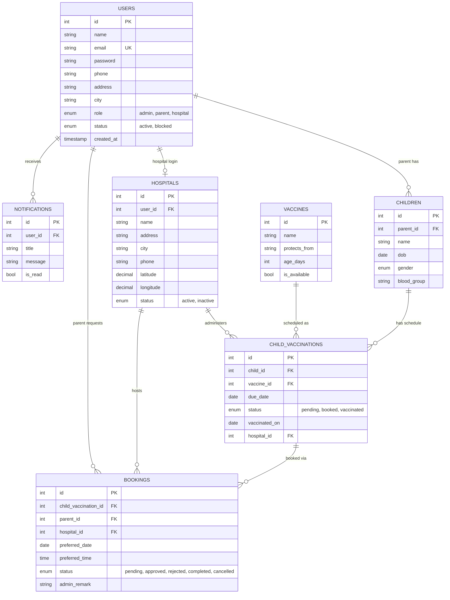

# Entity Relationship Diagram: VaxTrack

Paste the Mermaid block below into https://mermaid.live to see the picture, then export it as PNG or SVG for the project report.

## Table summary

| Table | Purpose |
|---|---|
| users | One login table for admin, parent and hospital (role column) |
| hospitals | Hospital profile, linked to its login |
| children | Children registered by a parent |
| vaccines | Master vaccination schedule (age in days, availability) |
| child_vaccinations | Personal schedule generated for each child, one row per vaccine |
| bookings | Parent request, admin decision and hospital result |
| notifications | Dashboard alerts |